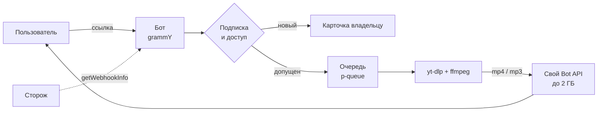

<div align="center">


# YouTube Downloader Bot

**Личный Telegram-бот: видео или звук с YouTube по ссылке, файлы до 2 ГБ**<br>
<sub>Personal Telegram bot that fetches YouTube videos or audio via yt-dlp and delivers files up to 2 GB through a self-hosted Bot API</sub>

[](https://t.me/dwl_youtube_robot)


</div>

---

Присылаешь ссылку на YouTube и получаешь видео файлом. Если дописать `audio`, придёт только звук в mp3. Скачивает [yt-dlp](https://github.com/yt-dlp/yt-dlp), склеивает ffmpeg, отправляет [grammY](https://grammy.dev).

> Бот **личный**: каждого нового человека владелец одобряет вручную. Репозиторий выложен как пример кода, а не как сервис. Своего бота можно развернуть по инструкции ниже.

## 🏗 Как устроено



## 🧠 Инженерные решения

| Задача | Решение |
|---|---|
| Видео больше 50 МБ | Свой `telegram-bot-api` в режиме `--local`: бот отправляет файлы до ~1,9 ГБ |
| Одна зависшая отправка не должна останавливать бота | Обработчик сообщения не ждёт задачу, а сразу берёт следующее. Задача ограничена временем: загрузка + 30 минут на отправку большого файла |
| Процесс жив, а сообщения не читаются | **Сторож** раз в 5 минут смотрит `getWebhookInfo`. Если непрочитанные висят 15 минут, процесс выходит, pm2 поднимает его заново |
| Сервер общий с другими сервисами | Очередь, проверка свободного места до старта, временные файлы удаляются сразу после отправки |
| Ссылка попадает в командную строку | yt-dlp запускается массивом аргументов, без shell; ссылка проходит проверку домена |

Защита от зависания пришла из соседнего [tiktok-downloader](https://github.com/digmen/tiktok-downloader): 08.11.2026 он на той же архитектуре молчал 4,5 дня из-за одной зависшей отправки. Проверено подменённым Telegram: отправка висит, а бот отвечает на другие сообщения за 1 мс.

## ✨ Что умеет

- принимает ссылку на YouTube (youtube.com, youtu.be, shorts) и отвечает видео в mp4;
- `audio` в конце сообщения: вернёт только звук в mp3;
- очередь задач (по умолчанию одна загрузка за раз), проверка свободного места, таймаут на загрузку;
- большие файлы (до ~1.9 ГБ) через локальный Telegram Bot API; без него лимит Telegram 50 МБ;
- временные файлы удаляются сразу после отправки;
- журнал использования и статистика для владельца.

## 📢 Вход по подписке на канал

Прежде чем просить доступ, человек подписывается на канал владельца (`CHANNEL`). Подписался один раз — больше не спрашивают, отметка хранится в `data/subscribed.json`. Проверка идёт через `getChatMember`, а Telegram отвечает на неё только админам канала, поэтому бот должен быть в канале админом (без прав). Пока это не так, бот людей **не блокирует**, а раз в сутки напоминает владельцу, что нужно сделать. Владельца не проверяет. Пустой `CHANNEL` выключает вход.

## 🔒 Доступ по запросу

1. Незнакомый человек пишет боту. Бот отвечает «запрос отправлен» и ставит его в ожидание.
2. Владельцу приходит сообщение с кнопками «Разрешить» и «Отклонить».
3. Решение сохраняется в `data/allowed.json` и переживает перезапуск.
4. Пока владелец не нажал «Разрешить», человек ничего скачать не может. Открытой регистрации нет.

Владелец (`OWNER_ID`) допущен всегда.

## 🤖 Команды владельца

| Команда | Что делает |
|---|---|
| `/users` | список id, которым разрешён доступ |
| `/revoke <id>` | отозвать доступ |
| `/stats` | аптайм, счётчики с последнего перезапуска и итоги из журнала: уникальные пользователи, всего скачиваний, успешные и ошибочные, звук, окна 7 и 30 дней |
| `/activeusers` | кто реально скачивал: число загрузок, успешные, дата последней (до 50 человек) |

Для остальных пользователей работают `/start`, `/help`, `/ping`. Команды владельца от чужих молча игнорируются.

## 🚀 Установка

Нужны Node.js 18.15+, `yt-dlp`, `ffmpeg` и `ffprobe` в PATH.

```bash
git clone https://github.com/digmen/youtube-bot.git
cd youtube-bot
npm ci
cp .env.example .env     # впиши BOT_TOKEN и OWNER_ID
npm run check            # проверка синтаксиса
npm start
```

### Запуск через pm2

```bash
npm i -g pm2
pm2 start ecosystem.config.cjs
pm2 save
```

Процесс перезапускается сам, перезапуск по памяти при 300 МБ, мягкая остановка до 20 секунд (дожидается текущей загрузки).

## ⚙️ Переменные окружения

| Переменная | Обязательна | По умолчанию | Назначение |
|---|---|---|---|
| `BOT_TOKEN` | да | нет | токен от @BotFather |
| `OWNER_ID` | да | нет | Telegram id владельца |
| `ADMIN_CHAT_ID` | нет | пусто | куда слать предупреждения (мало места, ошибки загрузки) |
| `YTDLP_PATH` | нет | `yt-dlp` | путь к yt-dlp |
| `FFMPEG_PATH` | нет | `ffmpeg` | путь к ffmpeg |
| `FFPROBE_PATH` | нет | `ffprobe` | путь к ffprobe |
| `TMP_DIR` | нет | `./tmp` | временные файлы; `data/` создаётся на уровень выше |
| `QUEUE_CONCURRENCY` | нет | `1` | параллельных загрузок |
| `DOWNLOAD_TIMEOUT_SEC` | нет | `600` | таймаут одной загрузки |
| `MIN_FREE_DISK_MB` | нет | `2000` | минимум свободного места для приёма задания |
| `MAX_FILESIZE_MB` | нет | `1900` | максимальный размер файла |
| `TELEGRAM_API_ROOT` | нет | пусто | адрес локального Bot API, например `http://127.0.0.1:8082` |

## 📊 Журнал использования (`data/usage.jsonl`)

Каждая попытка скачивания дописывает одну строку JSON:

```json
{"ts":1792600000000,"userId":"123456789","username":"someone","ok":true,"audio":false}
```

- `ts`: время в миллисекундах;
- `userId`: Telegram id (строкой);
- `username`: ник на момент события (снимок, может смениться);
- `ok`: удалась ли загрузка;
- `audio`: запрашивался ли только звук.

Формат JSONL выбран сознательно: бот личный, событий сотни в месяц, отдельная база и зависимость не нужны. `/stats` и `/activeusers` читают этот файл при каждом вызове. Ошибка записи журнала не роняет сам бот. Папку `data/` нужно бэкапить: там и список допущенных, и вся статистика.

## 🗂 Структура

```
src/
  index.js        запуск, мягкая остановка
  bot.js          команды, доступ по запросу, основной обработчик
  access.js       allowed.json: допущенные и ожидающие
  channel.js      вход по подписке на канал (subscribed.json), тесты — channel.test.js
  usage.js        usage.jsonl: журнал и сводки
  downloader.js   yt-dlp / ffmpeg, проверка диска, уборка
  queue.js        очередь на p-queue
  urls.js         разбор и проверка ссылки
  errors.js       понятные пользователю ошибки
  config.js       чтение переменных окружения
ecosystem.config.cjs   конфиг pm2
```

## 💾 Данные на диске (`data/`, в git не попадает)

| Файл | Что лежит |
|---|---|
| `allowed.json` | кому разрешён доступ и кто ждёт решения |
| `subscribed.json` | кто прошёл вход по подписке |
| `usage.jsonl` | по строке на скачивание: когда, кто, удачно ли, звук или видео |

## 🎛 Эксплуатация

| Задача | Команда |
|---|---|
| Состояние | `pm2 status youtube-bot` |
| Журнал | `pm2 logs youtube-bot --lines 50` |
| Перезапуск | `pm2 restart youtube-bot` |
| Обновить yt-dlp | `yt-dlp -U` (YouTube часто ломает старые версии) |
| Проверить синтаксис и тесты | `npm run check` и `node --test src/channel.test.js` |

### Если бот замолчал

Процесс может быть `online` и при этом не отвечать. Проверка снаружи:

```bash
curl -s "<BOT_API_ROOT>/bot<TOKEN>/getWebhookInfo"
# "pending_update_count": 0 — бот забирает сообщения
# больше 0 и не уменьшается — бот не читает: pm2 logs, затем pm2 restart
```

Зависшая отправка сама завершится по пределу времени, а если бот всё-таки перестанет забирать сообщения, сторож перезапустит его через 15 минут.

## ⚠️ Ограничения

- только YouTube, плейлисты не качаются (одно видео за ссылку);
- нет куки и входа в аккаунт: видео с возрастным ограничением или приватные не скачаются;
- YouTube периодически меняется, поэтому `yt-dlp` нужно обновлять (`yt-dlp -U`);
- размер файла ограничен `MAX_FILESIZE_MB` и лимитом Telegram;
- тесты есть только у входа по подписке (`node --test src/channel.test.js`), остальное проверяется синтаксисом (`npm run check`);
- ответственность за то, что качать и как использовать, на владельце своего экземпляра: соблюдай условия YouTube и авторские права.

## 📄 Лицензия

[MIT](LICENSE)
